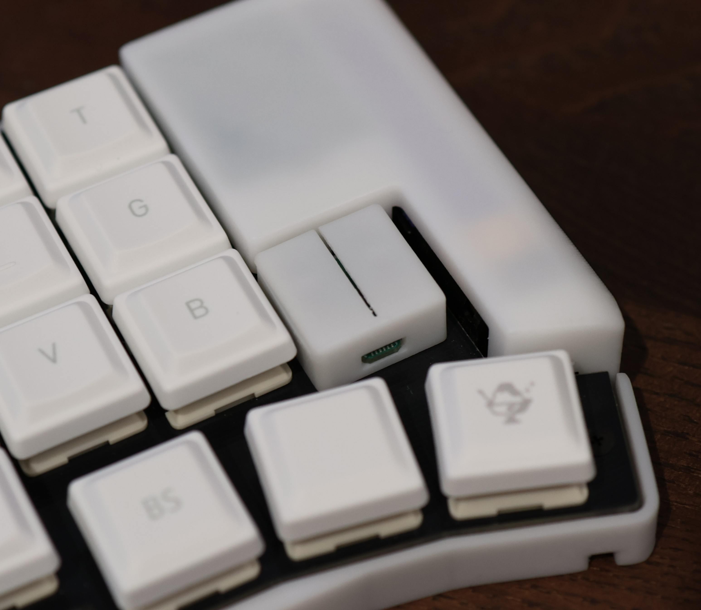
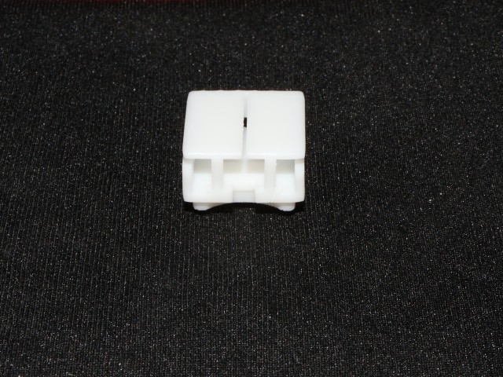
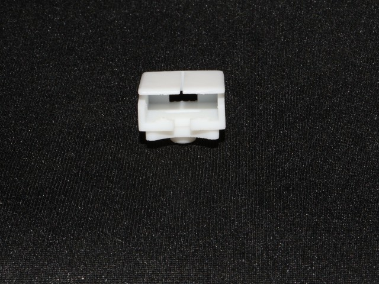
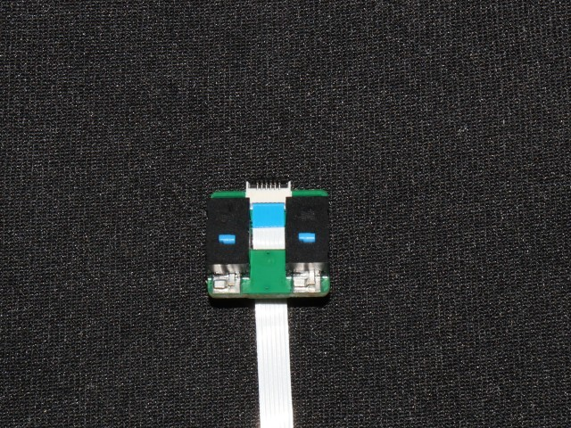
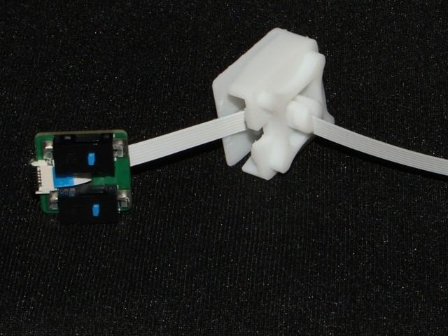
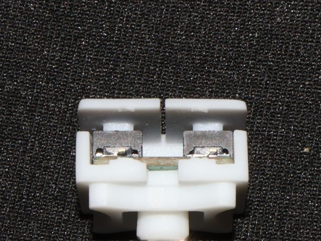

# マウスクリックモジュール

1Uサイズに2個のマウススイッチを搭載したモジュールです。

## 同梱部品

- 基板
- ケース(3Dプリント品)

## 別途ご用意が必要な部品

- 6P, 0.5mmピッチFPCケーブル(同一面)
  - コネクタとモジュールを配置したい場所の距離に応じて、必要な長さのケーブルをご用意ください

## 組み立て

- ケースのサポートをニッパーで切る
  |||
  |-|-|

- 基板にFPCケーブルを差し込む

  

- FPCケーブルの反対端を、ケースの中央穴に通す

  

- 基板をケースに差し込む

  

## ピン配置

0.5mmピッチ、6ピンのFPCで接続します。 同一電極面のFPCを使う場合、対向する側のコネクタでピン順が反転するので注意してください。

|番号|機能|説明|
|-|-|-|
|1|NC||
|2|COM||
|3|NC||
|4|B1|ボタン1|
|5|B2|ボタン2|
|6|NC||

## ドライバ

zmkのキーマトリクスに割り当て可能です